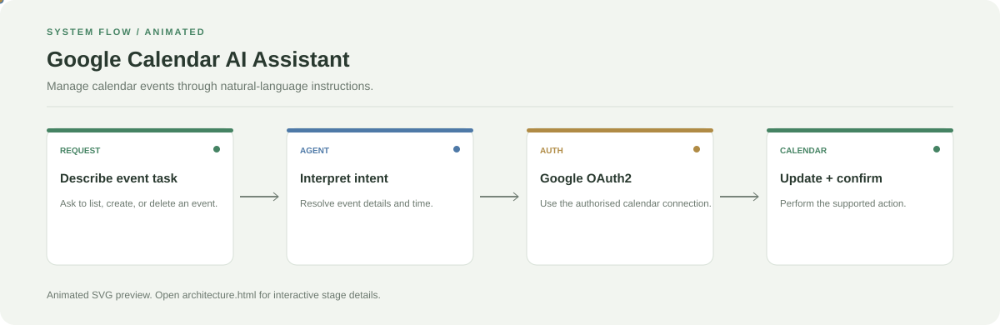

# Google Calendar AI Assistant

**Manage calendar events through natural-language instructions.**

[](https://github.com/chyk2468/Google-Calender-AI-Agent)

## 1. Project Title & Tagline

Manage calendar events through natural-language instructions.

## 2. Problem Statement

Creating, finding, or removing calendar events requires repeated manual form entry. This assistant routes supported natural-language requests to Google Calendar actions.

## 3. Project Preview

Add a real screenshot or short GIF showing the natural-language request, review step, and final result.

[Open interactive architecture](architecture.html)

## 4. Overview

The app accepts a natural-language request, resolves the intended operation, uses the configured integration to perform supported actions, and displays the result for review.

## 5. Key Features

- List upcoming events.
- Create events after confirmation.
- Find and delete events by title or keywords.
- Use recent context for follow-up requests.

## 6. Architecture / Workflow



Open the [interactive architecture explorer](architecture.html) to select a stage and inspect its role.

## 7. Tech Stack

Python, Streamlit, Groq/Llama, Google Calendar API, OAuth2

## 8. Installation & Setup

```bash
git clone https://github.com/chyk2468/Google-Calender-AI-Agent.git
cd Google-Calender-AI-Agent
python -m venv .venv
pip install -r requirements.txt
```

## 9. Usage

Configure the model key and Google OAuth credentials required by the app, then run `streamlit run app.py`. Check the calendar, date, local time zone, and target event before applying changes.

## 10. Project Structure

- `app.py`: interface
- `agent.py`: natural-language routing
- `actions.py`: event operations
- `calendar_client.py`: Calendar API wrapper
- `auth.py`: OAuth2 and token refresh

## 11. Results & Demo

Add a short demo showing event lookup and a confirmed create/delete action. Document which calendar operations are enabled in the current version.

## 12. Future Enhancements

- Confirm event details and time zone before write operations.
- Add tests for recurring events and ambiguous titles.
- Improve audit logs and API error handling.
- Support multiple calendars with explicit selection.

## 13. License

Check the repository licence before reuse. Never commit OAuth client secrets or refresh tokens.
