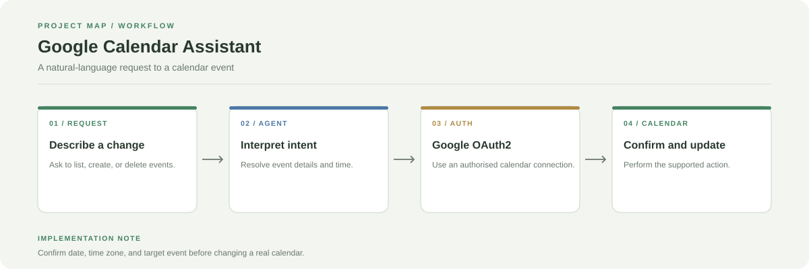

# Google Calendar AI Assistant

A Streamlit scheduling assistant that uses natural-language instructions to list, create, and delete Google Calendar events. It includes a confirmation step for event creation and supports follow-up requests using recent context.

**Stack:** Python, Streamlit, Groq/Llama, Google Calendar API, OAuth2



## What it does

- Lists upcoming events.
- Creates events after confirmation.
- Deletes events by title or keywords.
- Supports multiple event requests in a single interaction.
- Keeps recent context for follow-up commands.

## Project map

- `app.py`: interface
- `agent.py`: natural-language routing
- `actions.py`: event operations
- `calendar_client.py`: Calendar API wrapper
- `auth.py`: OAuth2 and token refresh
- `.env.example`: expected environment variable template, if present

## Run locally

```bash
git clone https://github.com/chyk2468/Google-Calender-AI-Agent.git
cd Google-Calender-AI-Agent
python -m venv .venv
```

Activate the environment, install dependencies, and configure the Groq key and Google OAuth credentials required by the app:

```bash
pip install -r requirements.txt
streamlit run app.py
```

Use Google's OAuth flow to grant the minimum calendar permissions required by your use case. Never commit client secrets or refresh tokens.

## Before applying changes

Check the intended calendar, date, local time zone, and event identity. Treat generated time details as a proposal until confirmed.
